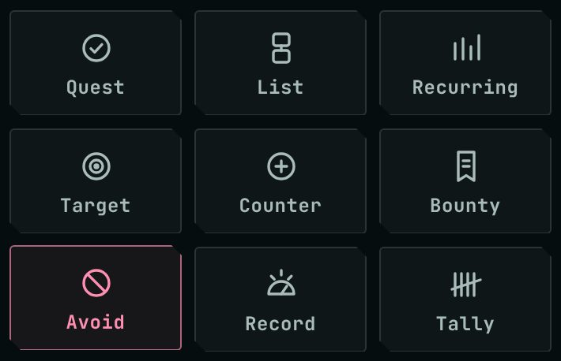
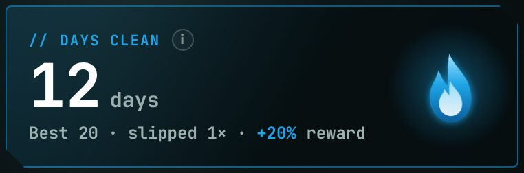
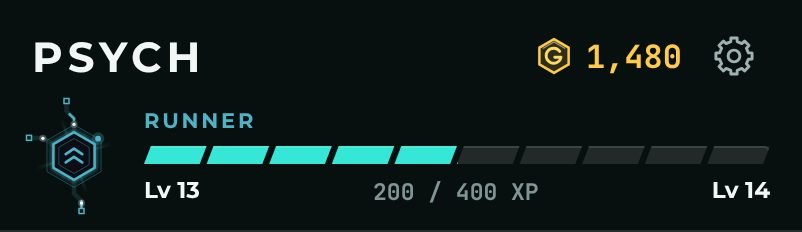
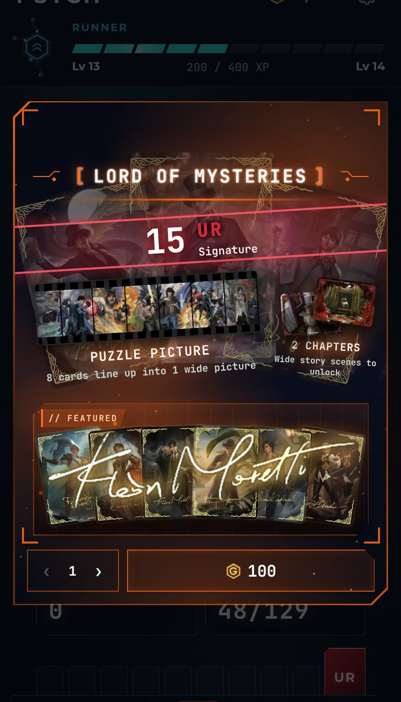
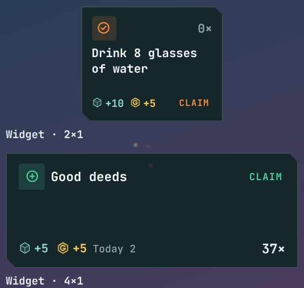
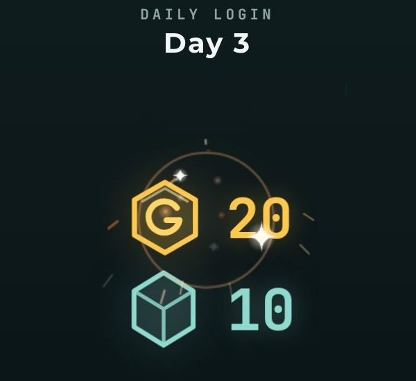
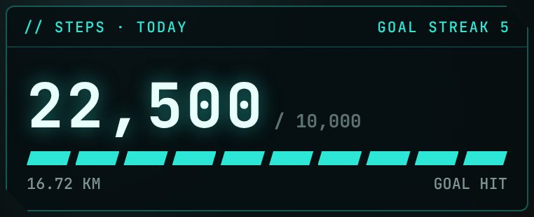

<p align="center">
  
</p>

<h1 align="center">Psych</h1>

<p align="center">
  A habit tracker that plays like a card game.<br>
  Clear real-life quests, keep streaks going, and spend what you earn on card packs.
</p>

<p align="center">
  <a href="https://github.com/Meih125/psych/releases/latest"></a>
  <a href="https://github.com/Meih125/psych/releases"></a>
  
  
  
</p>

<p align="center">
  <a href="https://github.com/Meih125/psych/releases/latest/download/Psych.apk"><b>⬇ Download the APK</b></a>
  &nbsp;·&nbsp;
  <a href="https://github.com/Meih125/psych/releases">All releases</a>
  &nbsp;·&nbsp;
  <a href="BUILD.md">Build it yourself</a>
</p>

<div align="center">

| Update | Released | What changed |
|:---:|:---:|:---:|
| **[v1.4.1](https://github.com/Meih125/psych/releases/tag/v1.4.1)** (latest) | Nov 8, 2026 | **[Patch notes](docs/patch-notes/v1.4.1.md)** |
| [v1.4.0](https://github.com/Meih125/psych/releases/tag/v1.4.0) | Nov 8, 2026 | [Patch notes](docs/patch-notes/v1.4.0.md) |
| [v1.3.1](https://github.com/Meih125/psych/releases/tag/v1.3.1) | Nov 5, 2026 | [Patch notes](docs/patch-notes/v1.3.1.md) |
| [v1.3.0](https://github.com/Meih125/psych/releases/tag/v1.3.0) | Nov 2, 2026 | [Patch notes](docs/patch-notes/v1.3.0.md) |
| [v1.2.1](https://github.com/Meih125/psych/releases/tag/v1.2.1) | Nov 1, 2026 | [Patch notes](docs/patch-notes/v1.2.1.md) |
| [v1.2.0](https://github.com/Meih125/psych/releases/tag/v1.2.0) | Oct 29, 2026 | [Patch notes](docs/patch-notes/v1.2.0.md) |
| [v1.1.2](https://github.com/Meih125/psych/releases/tag/v1.1.2) | Oct 28, 2026 | [Patch notes](docs/patch-notes/v1.1.2.md) |
| [v1.1.1](https://github.com/Meih125/psych/releases/tag/v1.1.1) | Oct 28, 2026 | [Patch notes](docs/patch-notes/v1.1.1.md) |
| [v1.1.0](https://github.com/Meih125/psych/releases/tag/v1.1.0) | Oct 27, 2026 | [Patch notes](docs/patch-notes/v1.1.0.md) |

</div>

## What it does

- **Quests** of many types.<br>
  
- **Streaks.**<br>
  
- **XP and gold.** Level up and spend gold on card packs.<br>
  <br>
  
- **Widgets** in different sizes. Claim quests without opening the app.<br>
  
- **Daily login reward.**<br>
  
- **Steps** sync from Health Connect.<br>
  

No account, no server, no ads. Everything stays on your phone.

## Install

1. Download **[Psych.apk](https://github.com/Meih125/psych/releases/latest/download/Psych.apk)**.
2. Open it and allow **Install unknown apps**.
3. If Play Protect warns, choose **Install anyway**. The app isn't on the Play Store, so Android doesn't know it.

## Build from source

Windows, Node.js 22+, Android Studio. Full steps in **[BUILD.md](BUILD.md)**:

```powershell
npm install
npm run setup
npm run open
```

## Project layout

```
www/            the app itself (index.html, css/, js/, fonts, images)
assets/         app icon sources
scripts/        build helpers (minimum Android version, widgets, app icon, version number)
tools/          preview builder and test data (not part of the app)
docs/           screenshots and patch notes
BUILD.md        how to build the APK
```

## Credits

Fan-made, personal project. Card art belongs to its original creators: *Lord of the Mysteries* (Tarot pack) and *Mobile Legends: Bang Bang* (Land of Dawn and Hand of Destiny packs, including the hero voice lines used as card text). Psych isn't affiliated with or endorsed by either.

Fonts: Montserrat, Inter, JetBrains Mono and Lora, all under the SIL Open Font License.
