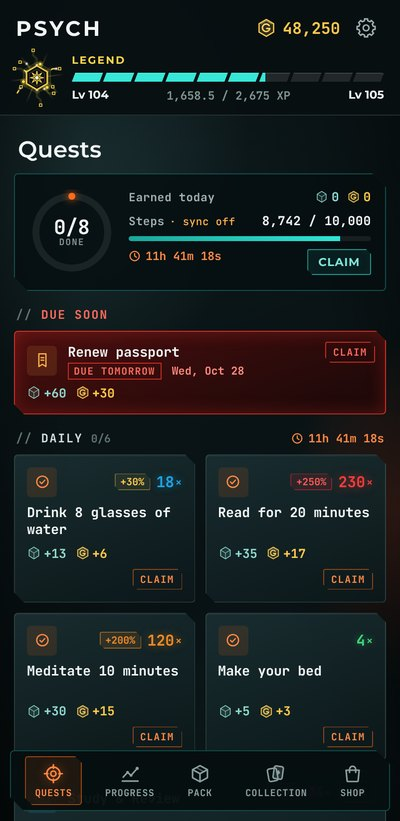
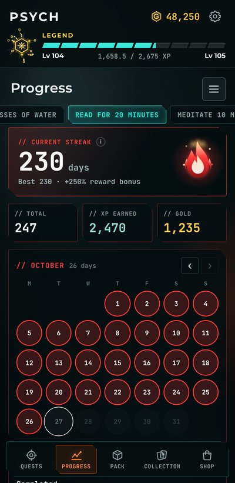
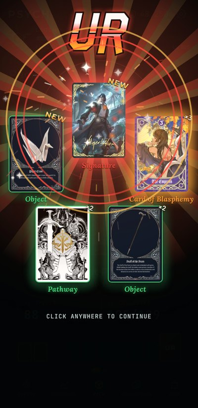
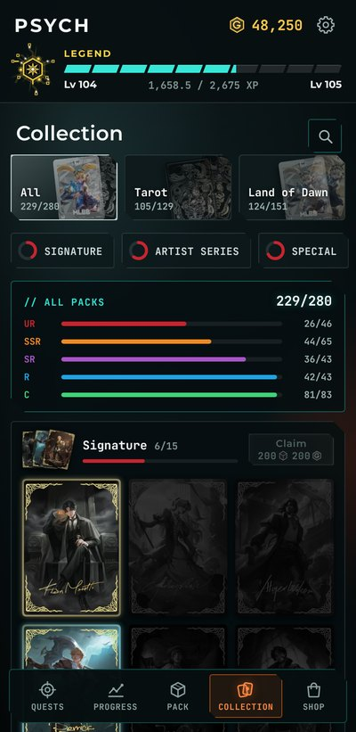

<p align="center">
  
</p>

<h1 align="center">Psych</h1>

<p align="center">
  A habit tracker that plays like a card game.<br>
  Clear real-life quests, keep streaks going, and spend what you earn on card packs.
</p>

<p align="center">
  <a href="https://github.com/Meih125/psych/releases/latest"></a>
  <a href="https://github.com/Meih125/psych/releases"></a>
  
  
  
</p>

<p align="center">
  <a href="https://github.com/Meih125/psych/releases/latest/download/Psych.apk"><b>⬇ Download the APK</b></a>
  &nbsp;·&nbsp;
  <a href="https://github.com/Meih125/psych/releases">All releases</a>
  &nbsp;·&nbsp;
  <a href="BUILD.md">Build it yourself</a>
</p>

<div align="center">

| Update | Released | What changed |
|:---:|:---:|:---:|
| **[v1.1.1](https://github.com/Meih125/psych/releases/tag/v1.1.1)** (latest) | Oct 28, 2026 | **[Patch notes](docs/patch-notes/v1.1.1.md)** |
| [v1.1.0](https://github.com/Meih125/psych/releases/tag/v1.1.0) | Oct 27, 2026 | [Patch notes](docs/patch-notes/v1.1.0.md) |

</div>

<p align="center">
  
  
  
  
</p>

## What it does

- **Quests** for anything you want to keep doing: daily or every few days, pairs, repeatable ones, targets, deadlines, "days clean" counters, personal records, running totals, and steps.
- **Streaks** add a bonus to a quest's rewards the longer you keep them going.
- **XP and gold.** Level up, and spend gold on card packs.
- **Cards.** Two packs to collect, with rarities from C to UR. Finished sets pay a reward.
- **Home-screen widgets** in four sizes. Claim quests without opening the app.
- **Arrange** your board: move quests around and make them half or full width.
- **Steps** sync from Health Connect (Samsung Health works through it).
- **Backups** are plain JSON files on your phone: manual ones whenever you like, plus an automatic one every night.

No account, no server, no ads. Everything stays on your phone.

## Install

1. Download **[Psych.apk](https://github.com/Meih125/psych/releases/latest/download/Psych.apk)** on your Android phone.
2. Open it and allow **Install unknown apps** when asked.
3. If Play Protect warns, choose **Install anyway**. The app isn't on the Play Store, so Android doesn't know it.

Updating: install the new APK over the old one. Your data is kept.

## Build from source

Windows, Node.js 22+, Android Studio. Full steps in **[BUILD.md](BUILD.md)**:

```powershell
npm install
npm run setup
npm run open
```

## Project layout

```
www/            the app itself (index.html, app.css, app.js, fonts, images)
assets/         app icon sources
scripts/        build helpers (minimum Android version, widgets, version number)
docs/           images for this page
BUILD.md        how to build the APK
HANDOFF.md      notes on how the code is organised
```

## Credits

Fan-made, personal project. Card art belongs to its original creators: *Lord of the Mysteries* (Tarot pack) and *Mobile Legends: Bang Bang* (Land of Dawn pack). Psych isn't affiliated with or endorsed by either.

Fonts: Montserrat, Inter, JetBrains Mono and Lora, all under the SIL Open Font License.
