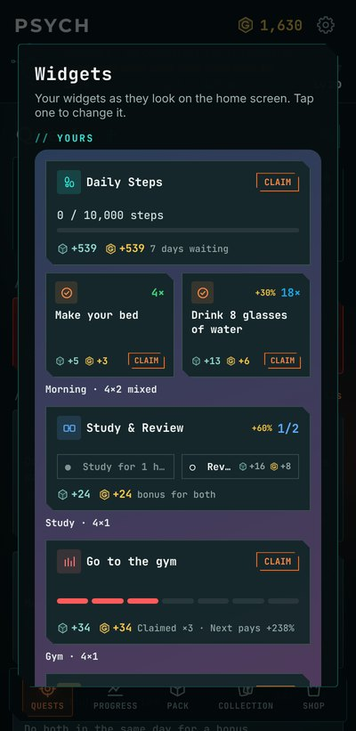
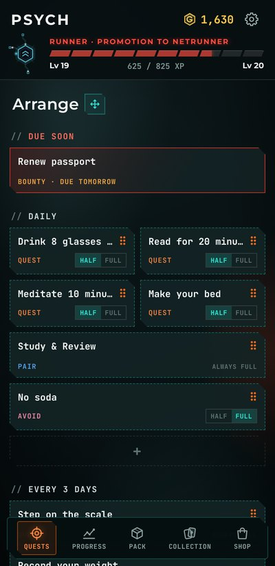
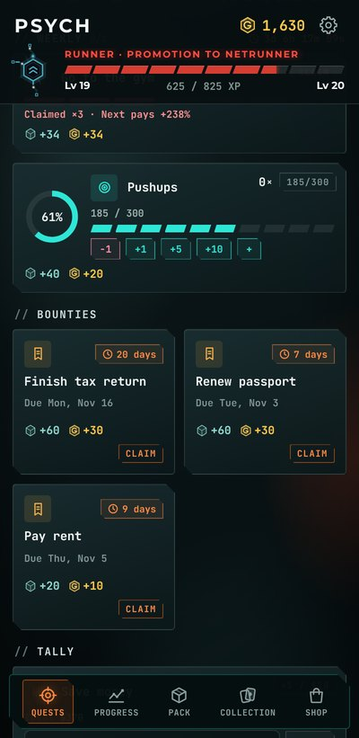
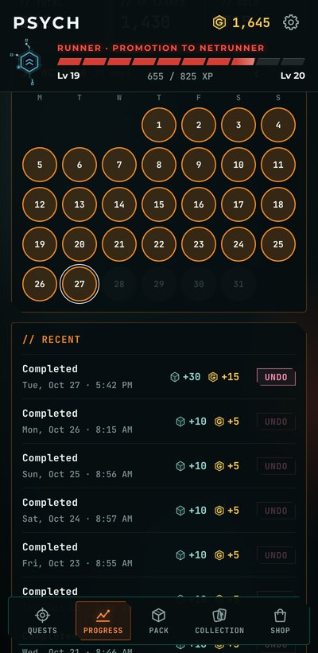

<h1 align="center">Psych v1.1.0</h1>

  Released Oct 27, 2026 &nbsp;·&nbsp;
  <a href="https://github.com/Meih125/psych/releases/download/v1.1.0/Psych.apk"><b>⬇ Download</b></a> &nbsp;·&nbsp;
  <a href="../../README.md">Back to Psych</a> &nbsp;·&nbsp;
  <a href="v1.1.1.md">Next: v1.1.1</a>

  
  
  
  

## New

- **Home-screen widgets.** Six layouts in four sizes: 2×1, 4×1, 2×2 and 4×2.
- **Arrange mode, reworked.** It now opens from the icon next to the Quests title.
- **Undo for more claims.** You can now undo most claims.

## Changes

- New animations.
- UI polish across the app.

## Fixes

- Bug fixes.

## Updating

Install the new APK over the old one. Your quests, cards and progress are kept.
