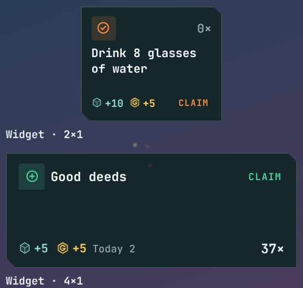
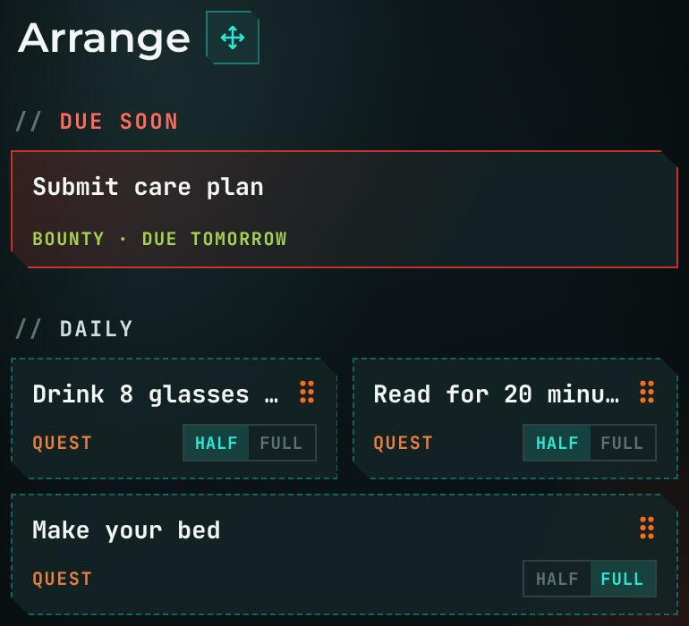
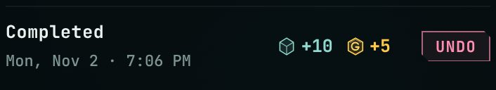

<h1 align="center">Psych v1.1.0</h1>

  Released Oct 27, 2026 &nbsp;·&nbsp;
  <a href="https://github.com/Meih125/psych/releases/download/v1.1.0/Psych.apk"><b>⬇ Download</b></a> &nbsp;·&nbsp;
  <a href="../../README.md">Back to Psych</a> &nbsp;·&nbsp;
  <a href="v1.1.1.md">Next: v1.1.1</a>

## Changes

- **Added home-screen widgets.** 6 layouts, 4 sizes. 
  
- **Reworked Arrange mode.** Opens from the icon next to Quests. 
  
- **Added undo for more claims.** 
  
- **Changed animations.** Claims, packs and rewards.
- **UI polish.**

## Fixes

- **Fixed some bugs.**

## Updating

Install the new APK over the old one. Your progress is kept.
