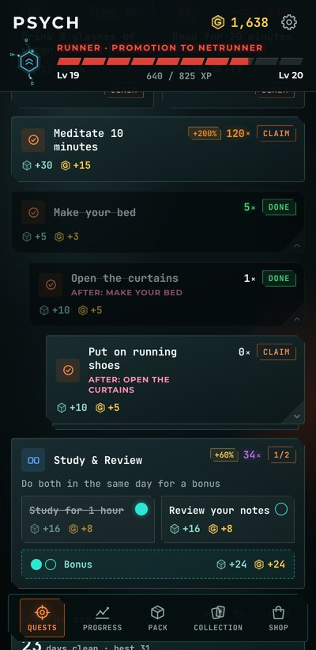

<h1 align="center">Psych v1.1.1</h1>

  Released Oct 28, 2026 &nbsp;·&nbsp;
  <a href="https://github.com/Meih125/psych/releases/download/v1.1.1/Psych.apk"><b>⬇ Download</b></a> &nbsp;·&nbsp;
  <a href="../../README.md">Back to Psych</a> &nbsp;·&nbsp;
  <a href="v1.1.0.md">Previous: v1.1.0</a>

  

## Changes

- **Follow-up quests, reworked.** They sit under their quest, fold away until it's done, and unlock one at a time. Related bugs fixed.
- **Updated app icon.**

## Fixes

- **Bug fixes** found by a new round of testing.
- **Optimization.**

## Updating

Install the new APK over the old one. Your progress is kept.
