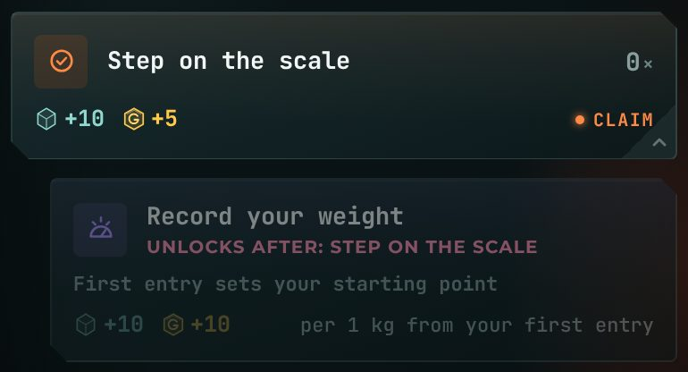

<h1 align="center">Psych v1.1.1</h1>

  Released Oct 28, 2026 &nbsp;·&nbsp;
  <a href="https://github.com/Meih125/psych/releases/download/v1.1.1/Psych.apk"><b>⬇ Download</b></a> &nbsp;·&nbsp;
  <a href="../../README.md">Back to Psych</a> &nbsp;·&nbsp;
  <a href="v1.1.0.md">Previous: v1.1.0</a> &nbsp;·&nbsp;
  <a href="v1.1.2.md">Next: v1.1.2</a>

## Changes

- **Reworked follow-up quests.** They sit under their quest and unlock one at a time. 
  
- **Updated the app icon.** 
  

## Fixes

- **Fixed some bugs.**
- **Optimized code.**

## Updating

Install the new APK over the old one. Your progress is kept.
