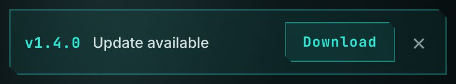
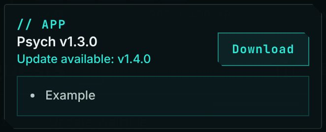

<h1 align="center">Psych v1.1.2</h1>

  Released Oct 28, 2026 &nbsp;·&nbsp;
  <a href="https://github.com/Meih125/psych/releases/download/v1.1.2/Psych.apk"><b>⬇ Download</b></a> &nbsp;·&nbsp;
  <a href="../../README.md">Back to Psych</a> &nbsp;·&nbsp;
  <a href="v1.1.1.md">Previous: v1.1.1</a> &nbsp;·&nbsp;
  <a href="v1.2.0.md">Next: v1.2.0</a>

## Changes

- **Added update check.** Once a day, with a banner on Quests. 
  
- **Added Settings > App.** Shows your version and a Check button. 
  

## Updating

Install the new APK over the old one. Your progress is kept.
