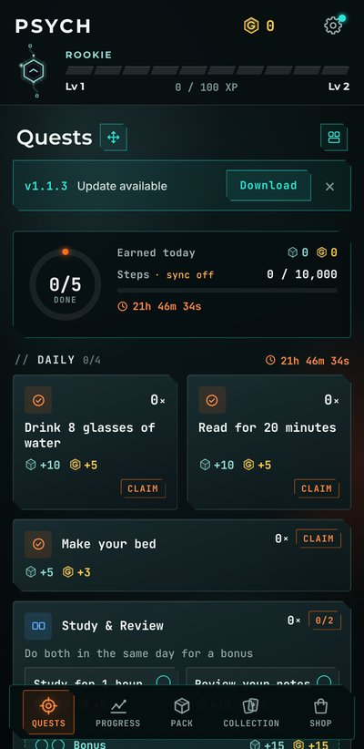

<h1 align="center">Psych v1.1.2</h1>

  Released Oct 28, 2026 &nbsp;·&nbsp;
  <a href="https://github.com/Meih125/psych/releases/download/v1.1.2/Psych.apk"><b>⬇ Download</b></a> &nbsp;·&nbsp;
  <a href="../../README.md">Back to Psych</a> &nbsp;·&nbsp;
  <a href="v1.1.1.md">Previous: v1.1.1</a> &nbsp;·&nbsp;
  <a href="v1.2.0.md">Next: v1.2.0</a>

  

## Changes

- **Update check.** Psych checks for a new version once a day. When one is out, a short "Update available" banner shows on Quests and the gear gets a dot. Tap **Download** to get it.
- **Settings > App** shows your version, what's new, and a **Check** button.

## Updating

Install the new APK over the old one. Your progress is kept. From now on, Psych tells you when the next update is out.
