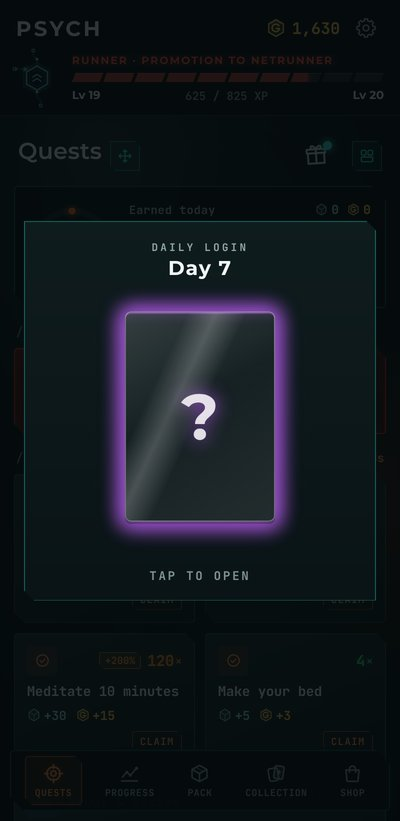

<h1 align="center">Psych v1.2.0</h1>

  Released Oct 29, 2026 &nbsp;·&nbsp;
  <a href="https://github.com/Meih125/psych/releases/download/v1.2.0/Psych.apk"><b>⬇ Download</b></a> &nbsp;·&nbsp;
  <a href="../../README.md">Back to Psych</a> &nbsp;·&nbsp;
  <a href="v1.1.2.md">Previous: v1.1.2</a>

  

## Changes

- **Added a daily login reward.**
- **Added more widget options.**
- **Changed some quests' UI and wording.**

## Fixes

- **Fixed some bugs.**
- **Optimized code.**

## Updating

Install the new APK over the old one. Your progress is kept. After updating, add the new widgets from Psych › Widgets.
