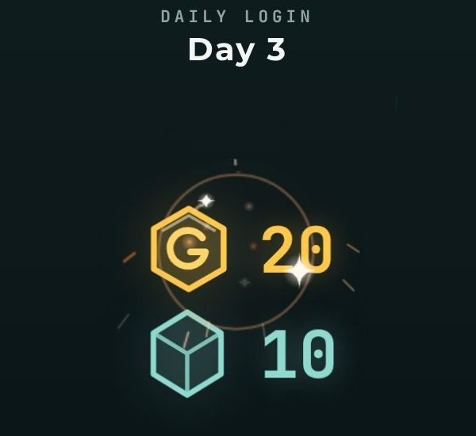
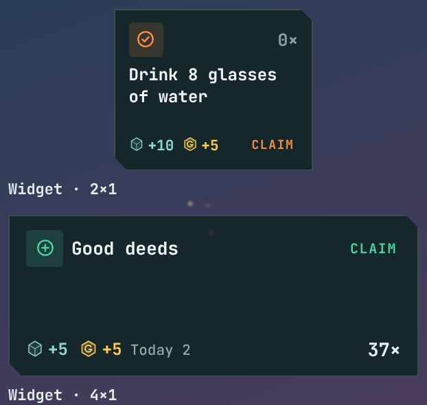
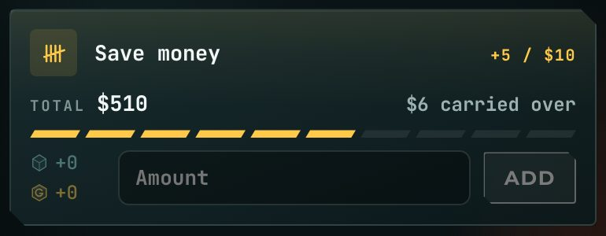
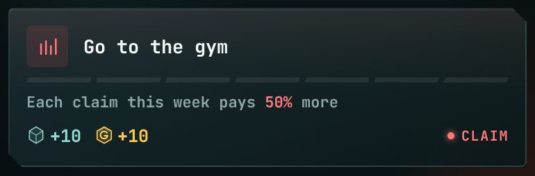

<h1 align="center">Psych v1.2.0</h1>

  Released Oct 29, 2026 &nbsp;·&nbsp;
  <a href="https://github.com/Meih125/psych/releases/download/v1.2.0/Psych.apk"><b>⬇ Download</b></a> &nbsp;·&nbsp;
  <a href="../../README.md">Back to Psych</a> &nbsp;·&nbsp;
  <a href="v1.1.2.md">Previous: v1.1.2</a> &nbsp;·&nbsp;
  <a href="v1.2.1.md">Next: v1.2.1</a>

## Changes

- **Added a daily login reward.** Gold, XP or a card. 
  
- **Added more widget sizes.** Up to 4×4. 
  
- **Changed Tally and Recurring UI.** 
   
  

## Fixes

- **Fixed some bugs.**
- **Optimized code.**

## Updating

Install the new APK over the old one. Your progress is kept.
