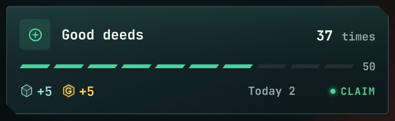
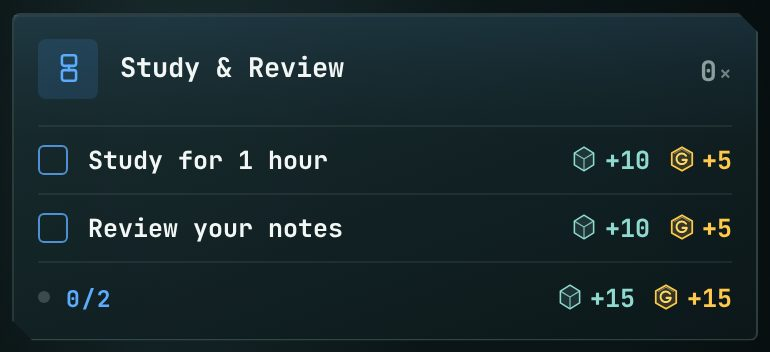
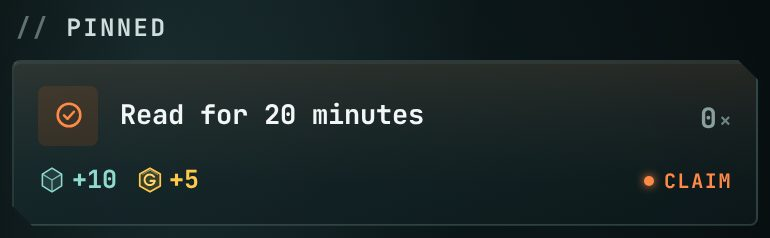
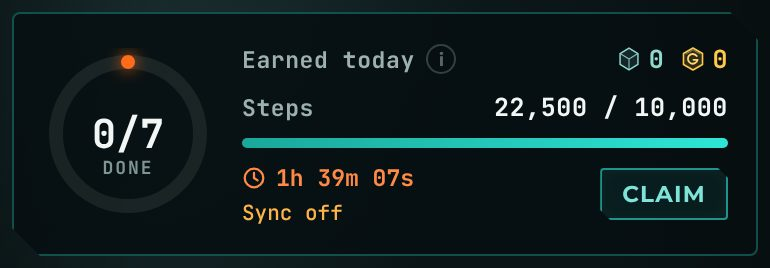
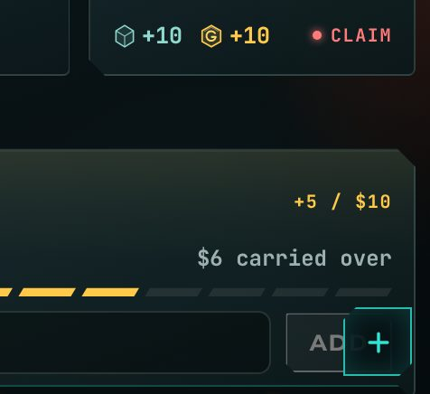
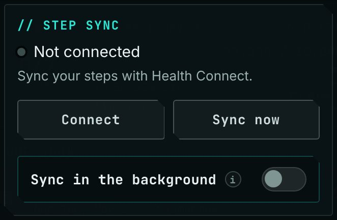
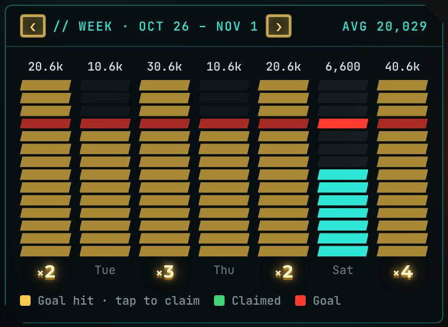
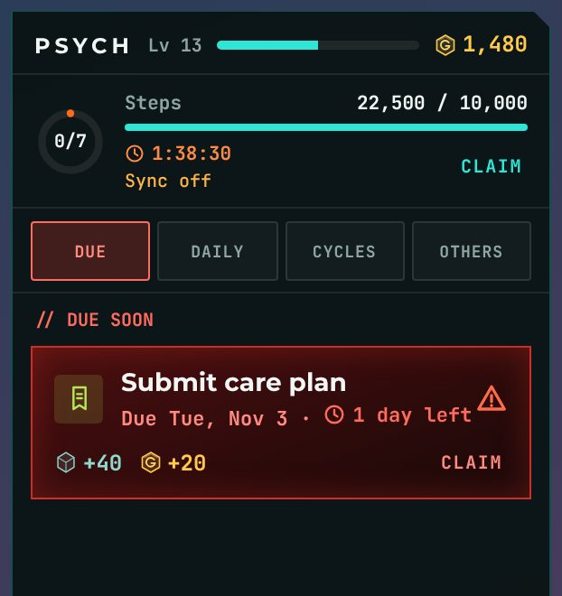
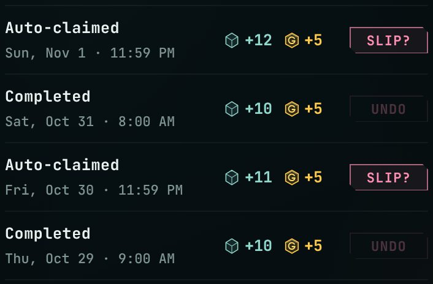

<h1 align="center">Psych v1.2.1</h1>

  Released Nov 1, 2026 &nbsp;·&nbsp;
  <a href="https://github.com/Meih125/psych/releases/download/v1.2.1/Psych.apk"><b>⬇ Download</b></a> &nbsp;·&nbsp;
  <a href="../../README.md">Back to Psych</a> &nbsp;·&nbsp;
  <a href="v1.2.0.md">Previous: v1.2.0</a> &nbsp;·&nbsp;
  <a href="v1.3.0.md">Next: v1.3.0</a>

## Changes

- **Added the Counter quest.** A flat reward per tap. 
  
- **Changed Pair quest to List.** 2 to 8 quests, bonus for all. 
  
- **Added pinned quests.** They sit at the top. 
   
  
- **Reworked the Quests page.** Quieter badges, Earned today breakdown. 
  
- **Added a floating Add Quest button.** 
  
- **Added background step sync.** Widgets update every 15 minutes. 
  
- **Added step goal bonus multiplier.** 
  
- **Reworked the 4x4 widget.** Pages, slimmer rows, Due Soon cards. 
  
- **Added Avoid auto-claim.** Clean days are claimed for you. 
  
- **UI polish.**

## Fixes

- **Fixed the tab bar on Android 16.**
- **Fixed the app icon size.**
- **Fixed some widget bugs.**
- **Fixed some bugs.**
- **Optimized battery use.**

## Updating

Install the new APK over the old one. Your progress is kept.
