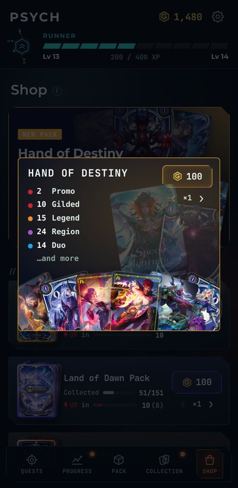

<h1 align="center">Psych v1.3.0</h1>

  Released Nov 2, 2026 &nbsp;·&nbsp;
  <a href="https://github.com/Meih125/psych/releases/download/v1.3.0/Psych.apk"><b>⬇ Download</b></a> &nbsp;·&nbsp;
  <a href="../../README.md">Back to Psych</a> &nbsp;·&nbsp;
  <a href="v1.2.1.md">Previous: v1.2.1</a>

  

## Changes

- **Added the Hand of Destiny pack.** 119 new cards, each with its own voice line.
- **Added pack details.** Tap a Shop banner to see what's inside and buy from there.
- **Added holo cards.** UR, SSR and Joker cards tilt and shine when you look at them.
- **Added collection arranging.** Hold a card to make it big, hold and drag to move it.
- **Added header pictures.** Tap a set's pictures to choose up to 3 to show.
- **Reworked set rewards.** Every set pays its own reward, and Poker claims by suit.
- **Reworked the collection display.** Uses a pin board style display.
- **Changed Weekly quests to reset on Monday.**
- **UI polish.**

## Fixes

- **Fixed some bugs.**
- **Optimized code.**

## Updating

Install the new APK over the old one. Your progress is kept.
