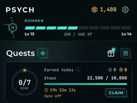
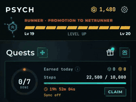
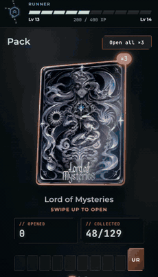
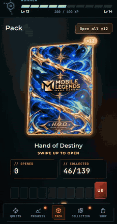
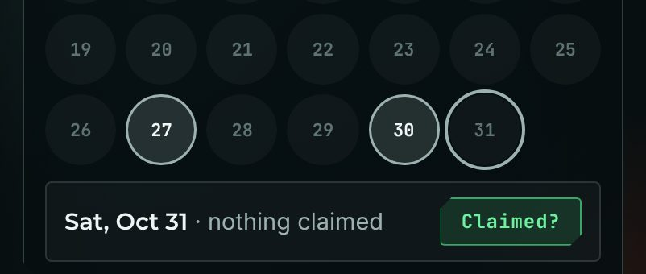
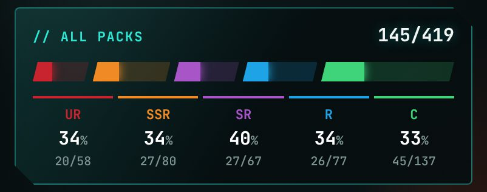
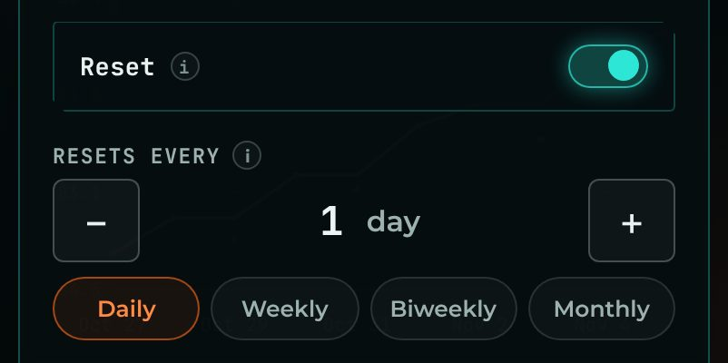
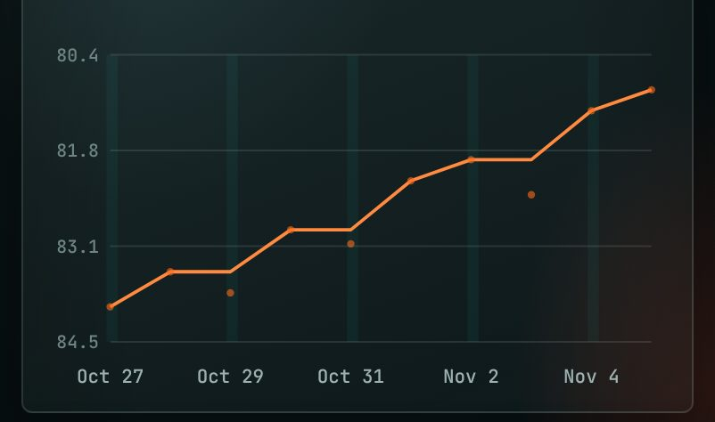
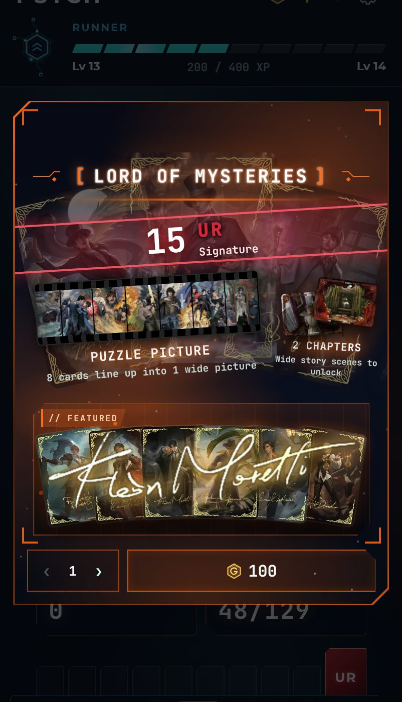

<h1 align="center">Psych v1.3.1</h1>

  Released Nov 5, 2026 &nbsp;·&nbsp;
  <a href="https://github.com/Meih125/psych/releases/download/v1.3.1/Psych.apk"><b>⬇ Download</b></a> &nbsp;·&nbsp;
  <a href="../../README.md">Back to Psych</a> &nbsp;·&nbsp;
  <a href="v1.3.0.md">Previous: v1.3.0</a>

## Changes

- **Added quest claim animation.** 
  
- **Added level-up animation.** 
  
- **Added pack opening animation.** Tap to skip. 
  
  
- **Added Claimed? button in Progress.** 
  
- **Reworked the Collection overview tab.** 
  
- **Added Reset toggle to Record quests.** Chart reworked. 
   
  
- **Reworked pack details.** 
  
- **Added card view button.** View a card without effects.
- **Added the Chibi set.** 20 rare chibi cards in H.O.D.
- **Updated patch note style for previous patch notes.**

## Fixes

- **Changed Biweekly quests to reset on every other Monday.**
- **Optimized animations and saving.**

## Updating

Install the new APK over the old one. Your progress is kept.
