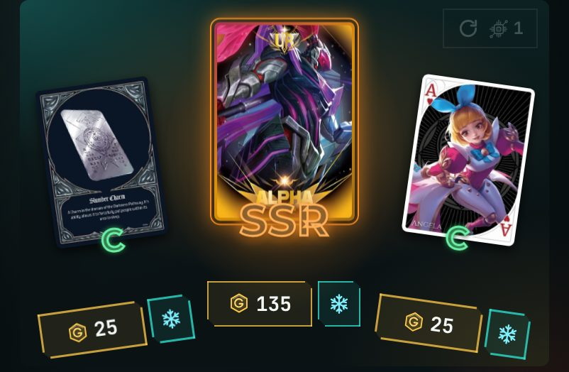
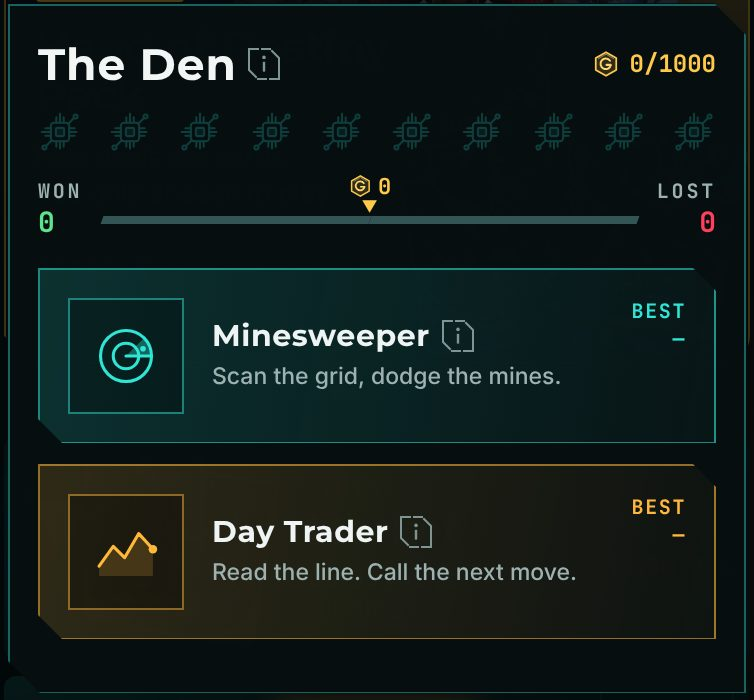
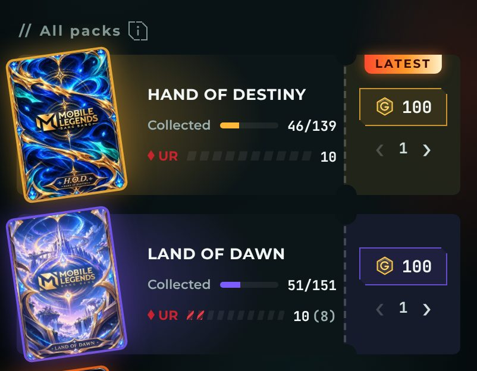

<h1 align="center">Psych v1.4.0</h1>

  Released Nov 8, 2026 &nbsp;·&nbsp;
  <a href="https://github.com/Meih125/psych/releases/download/v1.4.0/Psych.apk"><b>⬇ Download</b></a> &nbsp;·&nbsp;
  <a href="../../README.md">Back to Psych</a> &nbsp;·&nbsp;
  <a href="v1.3.1.md">Previous: v1.3.1</a>

## Changes

- **Added the Market.** Three cards a day. Freeze one to keep it. 
  
- **Added the Gambling Den.** Two games, played with tickets. 
  
- **Added tickets.** From daily login, level-ups, the first pack and step goals.
- **Added Market reroll.** Costs tickets.
- **Reworked the Shop.** Packs are now a ticket list. 
  
- **Reworked info icons.** One new look everywhere.
- **Merged the reward chip.** One chip when XP and gold match.
- **Changed "can't afford" to red.** The price turns red and the button shakes.
- **UI polish.**

## Fixes

- **Fixed Undo and late claims breaking streaks.**
- **Fixed Claimed? letting you claim days before a quest existed.**
- **Fixed the done ring for Records with Reset off.**
- **Fixed the header gold showing a wrong amount.**
- **Fixed some List and widget bugs.**
- **Optimized claims, numbers and code.**

## Updating

Install the new APK over the old one. Your progress is kept.
