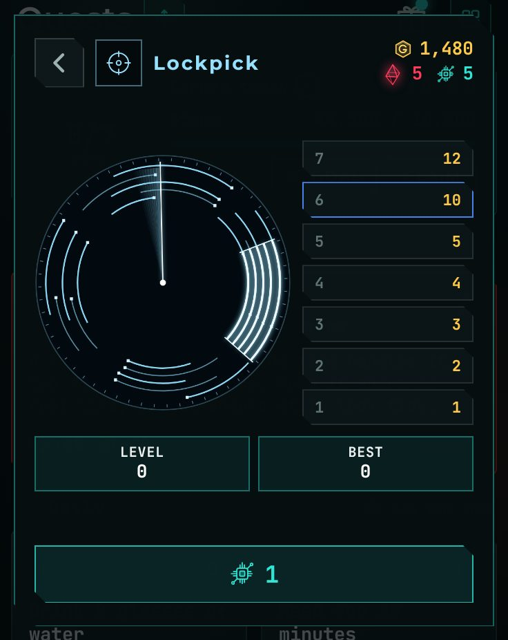
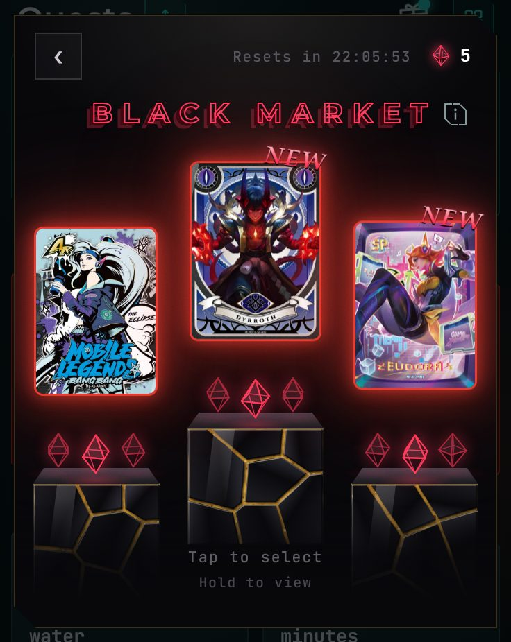
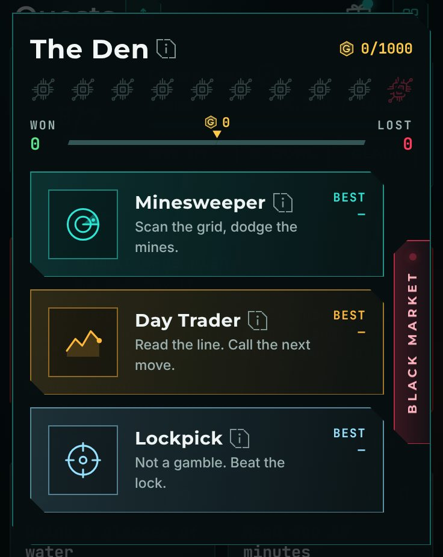

<h1 align="center">Psych v1.5.0</h1>

  Released Nov 10, 2026 &nbsp;·&nbsp;
  <a href="https://github.com/Meih125/psych/releases/download/v1.5.0/Psych.apk"><b>⬇ Download</b></a> &nbsp;·&nbsp;
  <a href="../../README.md">Back to Psych</a> &nbsp;·&nbsp;
  <a href="v1.4.1.md">Previous: v1.4.1</a> &nbsp;·&nbsp;
  <a href="v1.5.1.md">Next: v1.5.1</a>

## Changes

- **Added Lockpick.** A third Den game. Tap when the needle is in the gap. 
  
- **Added Gems.** Earned in Lockpick at levels 12 and 18.
- **Added the Black Market.** Spend 3 Gems for a UR card. 
  
- **Added a free play.** Every tenth Den play costs no ticket. 
  
- **Added heat colours to the Den.** The screen heats up as you go.
- **Added half-size Record, Tally and List tiles.** Lists can have a column of neighbours.
- **Added The Den to Earned today.** One row per game, with the gold won or lost.
- **Added a Goal button on Quests.** Claim your step goal from the step card.
- **Reworked pack opening.** A new foil NEW tag with a shine, and flipped cards bob.
- **Made the Den and its three games one size.** Smoother fades between them.
- **Made the Black Market slide out of the Den card.** Buying a card shows +UR on the Collection tab.
- **Added idle motion.** The Lockpick dial turns and the Day Trader cursor blinks.
- **Made Lockpick a little harder at high levels.**
- **Made all hint bubbles use one font.**
- **UI polish.**

## Fixes

- **Fixed the Record and Tally boxes keeping the old number.**
- **Fixed the Black Market sitting off-centre on big screens.**
- **Fixed some bugs.**

## Performance

- **Lockpick pauses the rest of the app.** Animations outside the Den hold still during a run.

## Updating

Install the new APK over the old one. Your progress is kept.
