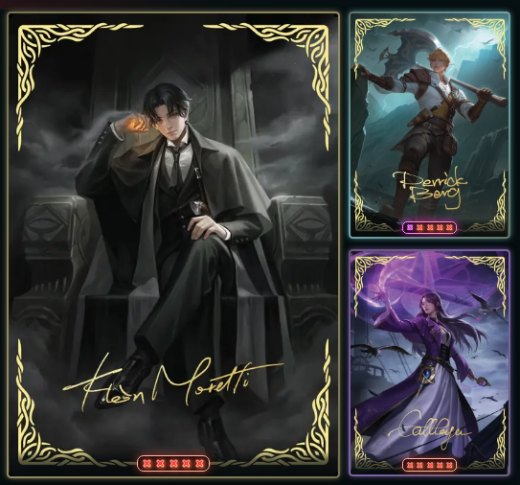

<h1 align="center">Psych v1.5.2</h1>

  Released Nov 12, 2026 &nbsp;·&nbsp;
  <a href="https://github.com/Meih125/psych/releases/download/v1.5.2/Psych.apk"><b>⬇ Download</b></a> &nbsp;·&nbsp;
  <a href="../../README.md">Back to Psych</a> &nbsp;·&nbsp;
  <a href="v1.5.1.md">Previous: v1.5.1</a>

## Changes

- **Added card levels and stars.** Every card has a level from 1 to 16. Extra copies level them up. 
  
- **Added the Level up screen.** Shows every card that levelled up after gaining cards.
- **Added set stars.** Each set claim raises the set's level. Higher stars pay more.
- **Added Lockpick Training.** Tap < or > on Start. Free, no reward, best level still counts.
- **Added a step streak flame on Quests.** Plus a banner when your streak ends tonight.
- **Changed the Collection level mark.** A star bar on the bottom edge of each card.
- **Adjusted Market prices.** C 20, R 35, SR 75, SSR 140, UR 220.
- **Adjusted Lockpick rewards.**

## Fixes

- **Fixed Lockpick spinning after a miss.** The needle and ring now stay where they stopped.

## Updating

Install the new APK over the old one. Your progress is kept.
