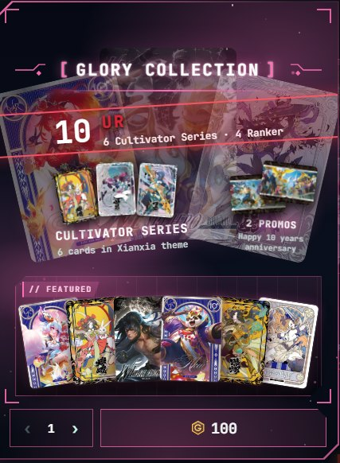
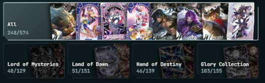

<h1 align="center">Psych v1.6.0</h1>

  Released Nov 17, 2026 &nbsp;·&nbsp;
  <a href="https://github.com/Meih125/psych/releases/download/v1.6.0/Psych.apk"><b>⬇ Download</b></a> &nbsp;·&nbsp;
  <a href="../../README.md">Back to Psych</a> &nbsp;·&nbsp;
  <a href="v1.5.2.md">Previous: v1.5.2</a>

## Changes

- **Added the Glory Collection pack.** 155 cards for Mobile Legends' 10th anniversary. 
  
- **Added card display to the All tile.** Showcases your latest URs and SSRs. 
  
- **Changed back-claiming on Progress.** Claim? is disabled when the quest was already claimed in that reset period.
- **Changed Progress to open on the Steps tab when a claim is available.** Tap Progress while its dot is lit and it opens on the Steps tab.
- **Adjusted UR and SSR card borders.** Hand of Destiny and Glory Collection cards now get new borders in the Collection view.

## Fixes

- **Fixed the Tally bar animation.**

## Updating

Install the new APK over the old one. Your progress is kept.
